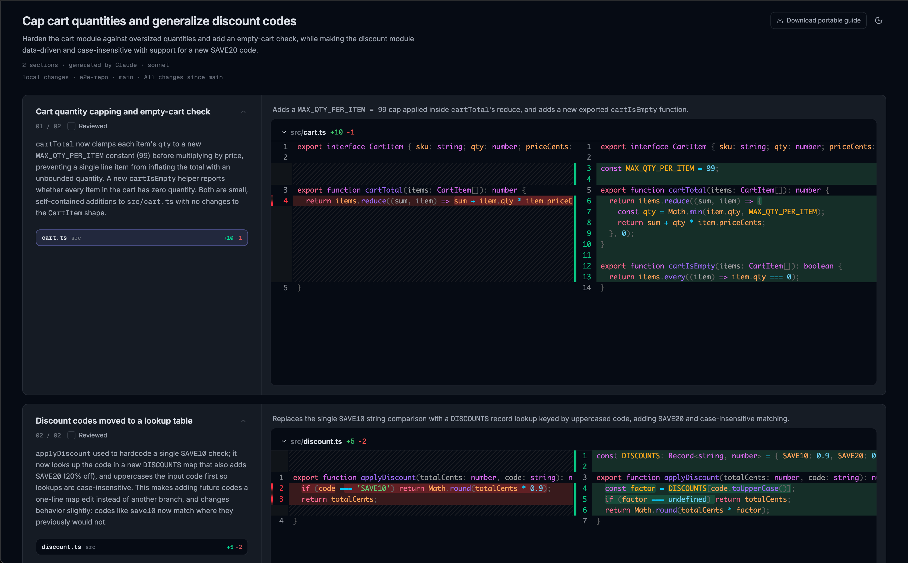
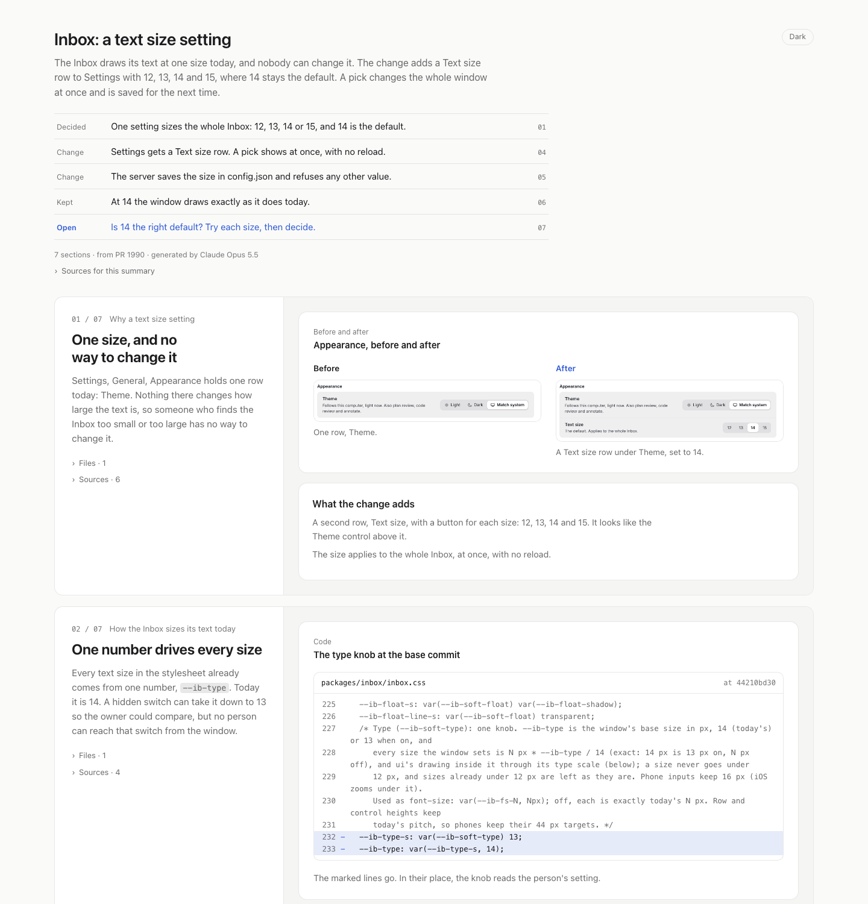

# Guided reviews and guided plans

Two agent skills that turn a code change into one HTML page a person can read in one sitting:

- **[guided-review](skills/guided-review/SKILL.md)**: a chaptered walkthrough of a diff that is already written, with the real diffs inline.
- **[guided-plan](skills/guided-plan/SKILL.md)**: a guided plan for a change, taught in plain words, with big pictures and few words, where every claim is cited and re-checked against the code.

Share the HTML file, or (for guided reviews) use the optional encrypted share service:
  - (optional) the guide is uploaded to [guides.show](https://guides.show) encrypted; the server can't read it, only people with the link can.

Guided reviews are also built into [Plannotator Code Review](https://github.com/backnotprop/plannotator).

<a href="https://github.com/backnotprop/plannotator"></a>

## Install

```bash
npx skills add plannotator/guides
```

This offers both skills. To install one: `npx skills add plannotator/guides --skill guided-plan`.

- **guided-review** needs git and the plannotator CLI (the minimal install is enough if you don't use the Plannotator UI):

  ```bash
  curl -fsSL https://plannotator.ai/install.sh | bash -s -- --minimal
  ```

- **guided-plan** needs git and Node 18 or later. Its build script ships inside the skill; there is nothing else to install.

### Renamed: plannotator-guide is now guided-review

The skill that used to be called `plannotator-guide` is now `guided-review`. Its instructions did not change. If you installed it before, switch with:

```bash
npx skills remove plannotator-guide        # add -g if you installed it globally
npx skills add plannotator/guides
```

Until you do, the old copy keeps working, since the `plannotator guide export` command it runs has not changed. `npx skills update` reports that `plannotator-guide` was deleted upstream. Run in a terminal, it offers to remove the old copy; with `-y` or without a terminal it only reports it and removes nothing. It never installs the new name for you.

## Guided reviews

Ask your agent for a guide, walkthrough, or tour of a branch, PR, commit, or uncommitted work. It saves the diff, writes `guide.json`, runs the export, and gives you the path to the HTML. Open it in any browser, or run the same thing from a PR pipeline with whichever agent you use there.

The guide shape and the full flow are in [`skills/guided-review/SKILL.md`](skills/guided-review/SKILL.md).

### How it works under the hood

The agent reads the diff and writes the guide. The [plannotator](https://plannotator.ai) CLI validates it, adds repo, branch and commit, and writes the HTML:

```bash
plannotator guide export --guide guide.json --patch guide.patch
```

For a link instead of a file:

```bash
plannotator guide share --guide guide.json --patch guide.patch
```

That prints the URL and a delete token. The key is the part of the URL after `#`, which browsers never send to the server, so guides.show only ever holds encrypted data. `--public` skips the encryption so chat apps can show a preview. `plannotator guide unshare <id> --token <token>` removes it. Nothing is uploaded unless you ask for a link.

The code that displays a guide loads from guides.show and never changes out from under a file, so old files keep working. guides.show itself is a small Cloudflare Worker you can run yourself; see [`apps/guides-show`](https://github.com/backnotprop/plannotator/tree/main/apps/guides-show) in the Plannotator repo and set `PLANNOTATOR_GUIDE_SHARE_URL` to your own host.

### What one looks like



## Guided plans

Ask your agent for a guided plan of a change: an issue, a PR you are about to open, or a plan document. It reads the change and the code it touches, writes `plan.json`, re-checks every citation, and builds `guided-plan.html`.

The page opens with the title, one paragraph, and one-line rows (Decided, Change, Kept, Open) that jump to their sections. Each section is one card: on the left a small label, a heading of a few words, one paragraph, then the files and the sources; on the right one large picture, with the section's other points as small cards under it. The left side stays in view while the right side scrolls. The pictures are a fixed set any guided plan can use: a screenshot, a code excerpt, a list, a table, chips, a timeline, a flow of steps, layers, and a pair that sets two to four of them side by side (before and after). `j` and `k` move between sections. Light and dark; on a phone every picture reflows and nothing scrolls sideways.

What the build guarantees:

- **Cited.** Every section, card and picture names its sources; each source is a path and lines at a commit, with the exact text it relies on. `build.mjs --check` reopens each one with git and confirms the text is there, and that every code excerpt matches its commit byte for byte.
- **Plain words.** The build refuses house jargon, dashes standing in for commas, and any number on the page that is not inside a cited quote.
- **Deterministic and offline.** The same `plan.json` gives the same bytes. Screenshots are embedded, so the page is one file with no network requests. `plan.json` and its screenshots are the source of the page; the HTML can always be built again from them.

```bash
node skills/guided-plan/system/build.mjs plan.json guided-plan.html
node skills/guided-plan/system/build.mjs --lint plan.json
node skills/guided-plan/system/build.mjs --check plan.json [--repo name=/path/to/clone]
```

The method, the content format (`guided-plan/2`) and every picture type are in [`skills/guided-plan/SKILL.md`](skills/guided-plan/SKILL.md). A `guided-plan/1` file (the earlier layout with lettered parts) is refused with a message that says what to change. Unknown fields are refused too, and [`guided-plan.schema.json`](skills/guided-plan/system/guided-plan.schema.json) is a JSON Schema of the format.

### Examples

- [`examples/paste-expiry`](examples/paste-expiry) is the worked example the skill points to: an invented small pastebin, pastebox, and a change that lets pastes expire. It uses every picture type. pastebox does not exist, so its repository is made on the spot, with the same commit hash every time:

  ```bash
  node skills/guided-plan/test/make-example-repo.mjs        # writes examples/paste-expiry/.repo
  cd examples/paste-expiry && node ../../skills/guided-plan/system/build.mjs --check plan.json
  ```

- [`examples/inbox-text-size`](examples/inbox-text-size) is the guided plan for a real, merged change in the open-source [Plannotator](https://github.com/backnotprop/plannotator) repository: the Inbox's Text size setting ([PR 1990](https://github.com/backnotprop/plannotator/pull/1990)), written as the plan it was. It cites the base commit `44210bd` for what existed and the merge commit `4507cdc` for what the change adds. The screenshots show a scratch Inbox with sample threads. Open `guided-plan.html` in a browser, or check it yourself:

  ```bash
  git clone https://github.com/backnotprop/plannotator
  node skills/guided-plan/system/build.mjs --check examples/inbox-text-size/plan.json --repo plannotator=plannotator
  ```



### Tests

```bash
node --test skills/guided-plan/test/*.test.mjs
```

They cover the format's refusals (unknown fields, reserved and colliding ids, unsafe keys and paths), the renderer on its own with hostile values, the word lint on every text field, colour contrast and forced colours, same input same bytes (and that the committed examples are current), the pure core building both examples byte for byte with no `process` or `Buffer`, every limit on untrusted input and a plan at the limits built in about a second, `--check` against the example's repository, and, when Playwright is available (`PLAYWRIGHT=/path/to/node_modules/playwright`), that nothing is wider than the window at 390, 1130 and 1440 px, light and dark, in headless Chromium. `node skills/guided-plan/test/render.mjs page.html --shots DIR` saves those renders.

## Related

- [Portable guide format](https://plannotator.ai/docs/reference/portable-guides/): what is in a guided review file, the snapshot format, share links, and guides.show.
- [Plannotator](https://github.com/backnotprop/plannotator): the review tool that generates guided reviews in-app.

Diffs in guided reviews are rendered with [diffs.com](https://diffs.com/).
